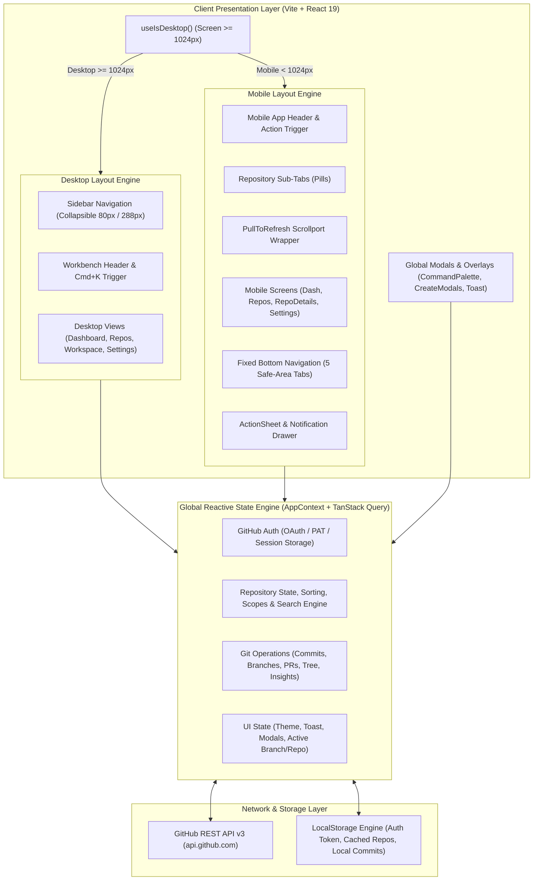

# Git Manager Studio Workbench — Comprehensive System Architecture & UI/UX Specification

## 1. Executive Summary & Product Vision

**Git Manager Studio Workbench** is a high-performance, developer-centric progressive web application (PWA) built with **React 19**, **TypeScript**, **Vite**, and **Tailwind CSS**. It serves as an all-in-one GitHub workspace and Git visualizer that functions with zero friction across **Desktop workstations** (dual-pane IDE layout, virtualized lists, code syntax highlighting, deep commit diffs, interactive activity charts) and **Mobile devices** (touch-optimized navigation, pull-to-refresh, bottom sheets, gesture-aware controls, and iOS/Android safe area ergonomics).

The platform interfaces directly with GitHub's REST & GraphQL APIs using either direct GitHub OAuth tokens or personal access tokens (PAT), maintaining reactive state, offline persistence, and seamless responsive switching.

---

## 2. High-Level System Architecture & Data Flow



---

## 3. Core Working Functions & Deep Mechanics

### 3.1 GitHub Connectivity & Authentication Cycle
- **PAT / OAuth Ingestion**: Supports GitHub tokens (`ghp_...`, `github_pat_...`) and OAuth token handshakes.
- **Header Injection**: Requests dynamically inject `Authorization: Bearer <token>` or `token <token>`, preventing unauthorized access.
- **Quota & Error Handling**: Intercepts 401 (Unauthorized) to trigger reconnection modals, and 422 (Validation Failed) on search queries with fallback sanitization.
- **Guest Mode / Mock Hydration**: When unauthenticated, the application displays an illustrative `UnauthenticatedState` guiding the user to enter their PAT or authenticate with GitHub.

### 3.2 Repository Search, Multi-Dimensional Sorting & Pagination Pipeline
- **Dual-Scope Search**:
  - `personal`: Filters fetched repositories in-memory without consuming GitHub Search API rate limits, matching `name`, `description`, `language`, and `owner`.
  - `global`: Dispatches rate-limited search requests to `https://api.github.com/search/repositories?q={sanitizedQuery}`.
- **Multi-Dimension Sorting**:
  - `updated`: Pushed timestamp descending / ascending.
  - `stars`: Stargazers count numeric sort.
  - `forks`: Forks count numeric sort.
  - `name`: Alphabetical Unicode collation.
  - `language`: Primary repository language collation.
- **Pagination**: Supports page sliding with ellipsis compaction (`1 .. 4 5 6 .. 12`) and virtualized rendering using `@tanstack/react-virtual` on desktop for 60 FPS scrolling through thousands of repositories.

### 3.3 Git Repository Deep Workspace Mechanics
When a repository is selected (`currentRepo` & `currentRepoOwner`), the application loads:
1. **Branch Manager**: Lists remote branches, tracks default branch, and supports switching the active branch context throughout the application.
2. **Commit History & Visual Diff Engine**: Fetches commit graphs with SHA hashes, author avatars, timestamps, and message parsing. Clicking a commit renders unified side-by-side or inline code diffs with syntax styling and stats (+ additions / - deletions).
3. **Pull Request Dashboard**: Displays open/closed PRs with status tags, review stages, author details, and direct GitHub links.
4. **Code File Explorer**: Reconstructs recursive tree nodes from the Git Tree API, displaying folders and files with expansion toggles, breadcrumb navigation, and rich syntax highlighting using `react-syntax-highlighter` (Prism).
5. **Interactive Insights & Pulse**: Recharts-powered telemetry showing commit activity, frequency distributions, and language composition pie charts.

---

## 4. Desktop Version Architecture & UI/UX Design

The Desktop version targets screens $\ge 1024\text{px}$ and operates as an integrated development workbench.

### Desktop Layout Wireframe Diagram

```
+---------------------------------------------------------------------------------------------------------+
| [Git Manager]  [Search / Command Palette  Cmd+K]                [+ Clone]  [+ New Repo]  [Theme] [User] |
+----------------+----------------------------------------------------------------------------------------+
| SIDEBAR        | MAIN WORKSPACE VIEWPORT                                                                |
| (80px / 288px) |                                                                                        |
|                | +------------------------------------------------------------------------------------+ |
| Workspace:     | | REPOSITORIES EXPLORER / DASHBOARD / ACTIVE REPO WORKSPACE                         | |
| [Home / Dash]  | |                                                                                    | |
| [Repositories] | | +--------------------------------+ +---------------------------------------------+ | |
| [Settings]     | | | Search & Multi-Sort Toolbar    | | Repository Inspector / Code Panel           | | |
|                | | | [Search input...] [Scope] [Sort| | Name: facebook/react   [Open Workspace]     | | |
| Active Repo:   | | +--------------------------------+ | Description: The library for web interfaces | | |
| [Commits]      | | | Virtualized Repo Card 1        | | Visibility: Public  |  Language: TypeScript | | |
| [PRs]          | | | Virtualized Repo Card 2        | | Stars: 230k | Forks: 45k | Watchers: 6.8k   | | |
| [Branches]     | | | Virtualized Repo Card 3        | +---------------------------------------------+ | |
| [Code Files]   | | | Virtualized Repo Card 4        | | Commits / File Tree & Syntax Highlighting   | | |
| [Insights]     | | +--------------------------------+ | [Dir] src/                                  | | |
| [Clone Setup]  | | | Pagination: < 1 2 3 4 5 >      | |   [File] index.tsx  --> Prism Code Preview   | | |
|                | | +--------------------------------+ +---------------------------------------------+ | |
| Footer Status: | +------------------------------------------------------------------------------------+ |
| [OK] v2.4.1    |                                                                                        |
+----------------+----------------------------------------------------------------------------------------+
```

### Desktop UI/UX Components Breakdown
1. **Collapsible Left Sidebar (`w-72` to `w-20`)**:
   - Brand glyph & title.
   - User profile badge with avatar, name, handle, bio, and connection status.
   - Global navigation: Dashboard Overview, Repositories Explorer, Settings Panel.
   - Contextual Active Repo sub-navigation (appears only when a repo is loaded): Commits History, Pull Requests, Branch Manager, Code Explorer, Insights, Clone Repository.
   - Station health indicator and app version pill.
2. **Top Workbench Header (`h-16`)**:
   - `Cmd+K` / `Ctrl+K` Command Palette launcher.
   - Quick "Clone Repo" and "+ New Repo" buttons.
   - Dark/Light theme toggle switch.
3. **Master-Detail Workspace**:
   - **Split Pane**: Left column lists repositories or file tree; right column inspects details, diffs, or syntax-highlighted source code.
   - **Virtualized Lists**: Handles massive repo collections without DOM bloat.
   - **Interactive Telemetry**: Recharts area charts with custom tooltips, toggles for commit frequency, PR activity, and language distributions.

---

## 5. Mobile Version Architecture & UI/UX Design

The Mobile version targets screens $< 1024\text{px}$ and delivers a responsive touch-first interface.

### Mobile Layout Wireframe Diagram

```
+------------------------------------+
| [Menu]     Git Manager      [+] [Q]| <-- Header (Sticky)
+------------------------------------+
| [Files] [Commits] [Branches] [PRs] | <-- Repo Sub-Tabs (Horizontal Scroll)
+------------------------------------+
| PULL-TO-REFRESH CONTAINER          |
|                                    |
| [Floating Top-Center Toast]        | <-- Status & Error Toasts (top-5 z-[300])
|                                    |
| +--------------------------------+ |
| | Repository Search & Scope      | |
| | [Search Input...............]  | |
| | [Personal | Global]  [Sort: v] | |
| +--------------------------------+ |
|                                    |
| +--------------------------------+ |
| | Repository Card 1              | |
| | owner/repo-name     [Public]   | |
| | Desc: Modern developer tool... | |
| | * 1.2k   Y 420   * TypeScript  | |
| +--------------------------------+ |
|                                    |
| +--------------------------------+ |
| | Repository Card 2              | |
| +--------------------------------+ |
|                                    |
| +--------------------------------+ |
| | Bottom Pagination Controls     | |
| | [<]  1  2  3  [>]              | |
| +--------------------------------+ |
|                                    |
+------------------------------------+
| [Home] [Repos] [Clone] [Act] [Set] | <-- Fixed BottomNav (Safe-Area Aware)
+------------------------------------+
```

### Mobile UI/UX Components Breakdown
1. **Mobile Sticky Header**:
   - Left menu button opening the slide-over **Notification & Account Drawer**.
   - Contextual Title & Branch Switcher Dropdown (with checkmarks and active branch indicators).
   - Quick Command Search icon, Notification badge with alert counter, and Plus (+) button triggering the **Action Sheet**.
2. **Horizontal Pill Tabs (`RepoTabs`)**:
   - Seamless swipeable pills for `Files`, `Commits`, `Branches`, `PRs`, and `Insights`.
   - Active tab highlighted with primary pill container.
3. **Pull-to-Refresh Viewport (`PullToRefresh`)**:
   - Elastic physics resistance on overscroll.
   - Animated SVG spinner and haptic release cues triggering live queries.
4. **Touch-Optimized Repositories Explorer**:
   - Scope switcher segmented control (`Personal` vs `Global`).
   - Clean sort dropdown button with active sort indicator badge.
   - Spacious repo cards with 44px minimum tap targets.
   - Safe-area bottom pagination bar preventing cutoff above navigation.
5. **Floating Top-Center Toast System**:
   - Positioned at `top-5 left-1/2 -translate-x-1/2 z-[300]`.
   - Never collides with bottom navigation or pagination bars.
   - Color-coded: Red for errors (`AlertCircle`), Green for successes (`CheckCircle2`), Blue for informational notifications (`Info`).
6. **Fixed Bottom Navigation Bar**:
   - 5 standard destinations: **Home** (`dash`), **Repos** (`repos`), **Clone** (`clone`), **Activity** (`commits`), and **Settings** (`settings`).
   - Integrated `pb-[max(0.75rem,env(safe-area-inset-bottom))]` for iPhone home indicator and Android navigation bars.

---

## 6. Comprehensive Component Matrix

| Component | Category | Desktop UX | Mobile UX |
| :--- | :--- | :--- | :--- |
| `Header` | Layout | Integrated in Workbench Bar | Sticky header with Drawer & Action triggers |
| `Sidebar` / `BottomNav` | Navigation | Left 72/20 width collapsible rail | 5-tab fixed bottom bar with safe-area pad |
| `Repositories` | Screen | Dual-pane master-detail with virtualizer | Card list with pull-to-refresh & pagination |
| `CommitsScreen` | Feature | Unified diff panel & CI/CD pipeline | Commit history timeline with touch diff modal |
| `FilesScreen` | Feature | Full IDE file tree with Prism code editor | Hierarchical folder tree with code sheet |
| `BranchesScreen` | Feature | Grid cards with branch protection tags | Vertical cards with quick checkout buttons |
| `PRsScreen` | Feature | Filterable tabs (Open/Closed) with stats | Compact cards with author avatars & badges |
| `InsightsScreen` | Analytics | Multi-chart Recharts dashboard | Responsive single-column activity charts |
| `CloneScreen` | Utility | 5-step configuration wizard with copy | Stacked configuration cards with 1-tap copy |
| `CommandPalette` | Shortcut | `Cmd+K` modal with fuzzy search | Top search icon trigger with full-screen list |
| `ActionSheet` | Overlay | Header quick-action buttons | Bottom slide-up sheet with gesture close |
| `Toast` | Feedback | Floating top-center pill | Floating top-center pill (anti-overlap) |

---

## 7. State Management & Offline Resilience

- **AppContext (`src/AppContext.tsx`)**: Central hub managing `currentScreen`, `currentRepo`, `githubUser`, `githubRepos`, `activeBranches`, `activeCommits`, `activeFiles`, and `toastMessage`.
- **Local Persistence**: Stores active credentials in `localStorage` under sanitized keys, handling quota boundaries safely.
- **Progressive Web App**: Offline service worker ready, web app manifest, and adaptive theme coloring for light and dark modes.
